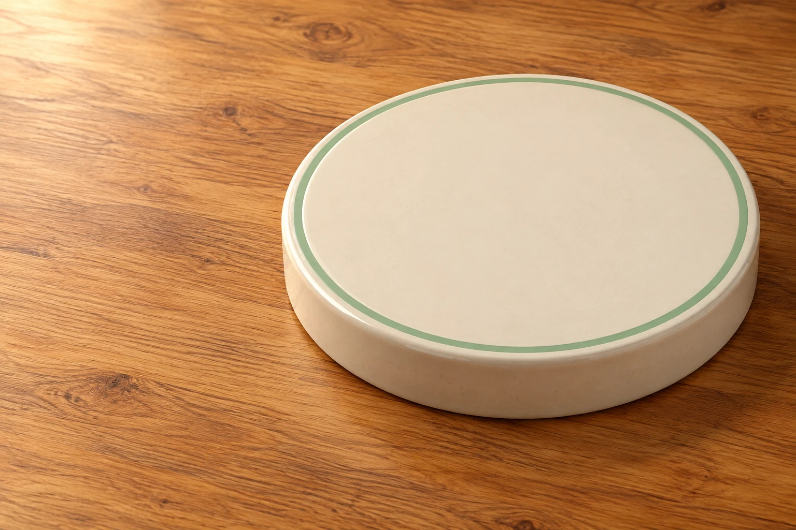

# Noillirk — Think common. Fly higher.

[English](#english) · [繁體中文](#繁體中文)

## English

[Explore Noillirk.co](https://noillirk.co/) · [How scoring works](https://noillirk.co/noillirk/scoring/) · [Explore the answer bank](https://noillirk.co/stats/)

A forest, three balloons, and seven chances to think like the crowd. Noillirk.co is an independent common-answer game: choose a familiar answer, watch your explorer rise, and discover an animated platform after each round.

### A little thought. A little lift.

- **Seven questions, your pace.** Choose timed Classic and Daily runs, or think without a clock in Practice.
- **See where every point comes from.** Relative answer weights produce scores from 1 to 100, with no speed bonus.
- **Watch your platform come alive.** Ten animated crowd-density levels keep you in the center.
- **Finish early when you are ready.** Skip wait submits your answer without waiting for the remaining timer.
- **Learn from your flight.** Review accepted answers, listed aliases and the limits of the answer bank.

*Original game artwork—not a screenshot of a finished round. The playable scene adds animated characters.*

### Clear about the numbers

Answer weights are original illustrative estimates, **not human survey results or PlayDaily records**. Platform figures show visual density, not a real headcount. The current small bank eventually repeats; missing answers are not automatically wrong.

**Public launch is being prepared.** Online play depends on the game service becoming available. Public multiplayer, accounts and competitive leaderboards are not currently offered.

[Understand your score](https://noillirk.co/noillirk/scoring/) · [Find the original Krillion](https://noillirk.co/krillion/) · [Compare the games](https://noillirk.co/noillirk-vs-krillion/)

Independent project; not affiliated with PlayDaily. For the original Noillirk, visit [PlayDaily](https://playdaily.org/noillirk).

## 繁體中文

[探索 Noillirk.co](https://noillirk.co/) · [了解評分](https://noillirk.co/noillirk/scoring/) · [查看答案資料](https://noillirk.co/stats/)

一片森林、三顆氣球，以及七次猜中常見答案的機會。Noillirk.co 是獨立的常見答案遊戲：選擇熟悉的答案，看著探險者升空，每題結束都有動態小人平台。

### 每個答案，都看得見回饋

- **七題，自選節奏。** Classic 與 Daily 有倒數，Practice 不限時。
- **分數有跡可循。** 依答案相對權重計算 1～100 分，不加速度獎勵。
- **動態人物平台。** 十個視覺密度等級，主角始終站在中央。
- **答完不用等。** Skip wait 提交目前答案，提前結束剩餘倒數。
- **逐題回顧。** 查看已收錄答案、別名及題庫限制。

*這是原創遊戲素材，不是結算截圖；實際遊戲會加入動態人物。*

### 清楚交代數字的來源

答案權重是本站原創的示意估計，**不是真人調查，也不是 PlayDaily 資料**。平台人物代表視覺密度，不是真實回答人數。現有題庫仍小，用完後會重複；未收錄不等於回答錯誤。

**公開版本正在準備中。** 線上遊玩仍需等待遊戲服務就緒，目前不提供公開多人、帳號或競技排行榜。

[理解分數](https://noillirk.co/noillirk/scoring/) · [尋找原版 Krillion](https://noillirk.co/krillion/) · [比較兩種玩法](https://noillirk.co/noillirk-vs-krillion/)

本專案獨立運作，與 PlayDaily 無關聯。原版 Noillirk 請前往 [PlayDaily](https://playdaily.org/noillirk)。
