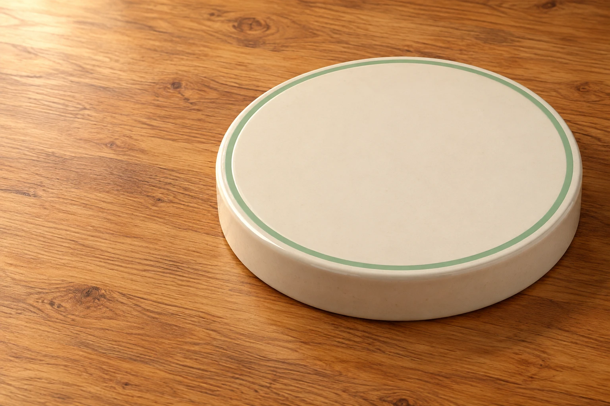

# Noillirk: Think Common, Fly Higher

[Visit Noillirk](https://noillirk.co/) to explore an independent common-answer game and the guides that explain its scoring. The premise is easy to understand: read a question, think of a familiar answer, and see how that answer fits the current question bank. A forest setting, a balloon explorer, and a rising platform turn a short sequence of questions into a small visual journey. The website also explains the limits of its data so that a number on the screen is not mistaken for a scientific measurement.

## Find Your Starting Point

The homepage introduces the project and provides routes into the available game and supporting information. If you are visiting for the first time, spend a moment with the scoring explanation before trying to optimize a result. The purpose is to recognize familiar possibilities, not to prove that an unusual answer is objectively incorrect. An answer can make sense in ordinary conversation and still be absent from a limited game bank.

[Read the scoring guide](https://noillirk.co/noillirk/scoring/) when you want to understand what the displayed values represent. [Explore the answer information](https://noillirk.co/stats/) when you want more context about coverage. These pages are useful companions to the game rather than shortcuts to a guaranteed score. The available entries, aliases, and estimated weights define the experience you are playing today.

## A Short Round With a Clear Rhythm

The documented game format uses seven questions. Classic and Daily modes use a timer, while Practice offers a less hurried way to think through a response. The difference matters if you are still getting comfortable with how the question bank recognizes answers. Start with a pace that lets you read carefully instead of treating every prompt as a race.

The documented scoring model does not award a separate speed bonus. A quick response and a considered response are therefore not automatically different in value merely because of how long they took. Where the game presents a Skip wait control, it lets you submit the current answer before the remaining countdown ends. Read the current interface and instructions before using it, especially if you are still revising your answer.

## Understand What a Score Means

Answer weights are original illustrative estimates. They are not the results of a human survey, a count of current players, or records obtained from PlayDaily. A displayed value describes the relationship between an answer and the project's current data model. It does not establish how a whole population would respond to the same question.

This distinction is important when a familiar answer receives a lower value than you expected. A game can only evaluate the information it contains. The question wording, accepted spelling, listed aliases, and relative weights all affect the outcome. Use the explanatory pages to understand those boundaries rather than assuming that a result measures intelligence, cultural knowledge, or the quality of your opinion.

The bank is limited and questions may eventually repeat. Repetition can make a later round feel more familiar, but it does not turn the recorded weights into independent evidence about real-world popularity. Missing answers are not automatically wrong answers. They may simply be outside the current coverage.

## Read the Visual Feedback

The forest and balloon explorer give the game a recognizable atmosphere. The platform artwork provides a stage for animated characters, while different crowd-density levels communicate a visual response. These figures are part of the presentation. They should not be read as a live headcount or as proof that a matching number of people selected your answer.

The images in this introduction are actual project assets. They show the logo, forest background, and wooden platform used by the website. The platform image is not a screenshot of a completed round: the playable scene adds its characters and interface separately. Keeping that distinction visible makes it easier to understand what the illustrations show without promising a particular result.

## Learn From the Answer Bank

A useful review starts with the exact question you were given. Look at what the prompt asks, then compare your response with the entries and aliases that the project documents. Two expressions that feel equivalent to a person may not both be listed. Checking the available information is more productive than repeatedly guessing whether an unexpected result was caused by spelling, coverage, or weighting.

The website's guides provide context for those differences. They are especially helpful if you want to distinguish the game rules from assumptions about common knowledge. A short round can be entertaining without offering a complete survey of every reasonable answer, and understanding that limitation makes the experience easier to judge fairly.

## Discover the Related Games

Noillirk.co is an independent development project and is not affiliated with PlayDaily. The names and original games discussed in its guides belong to their respective creators. A comparison page is an explanation of similarities and differences, not a statement that two games share the same implementation or answer database.

[Compare Noillirk and Krillion](https://noillirk.co/noillirk-vs-krillion/) for additional context, or [read the Krillion guide](https://noillirk.co/krillion/) to find information about that original game. For the original Noillirk experience, follow [PlayDaily's Noillirk page](https://playdaily.org/noillirk). These links help separate this independent project from the releases that inspired readers to search for it.

## Availability and Expectations

Online play depends on the availability of the game service. A description of a mode is not a guarantee that every service or experimental feature is publicly available at every moment. Follow the current notices on the website, particularly around test runs and room-based experiences. This introduction does not promise public multiplayer, account features, or competitive leaderboards.

Return to [Noillirk.co](https://noillirk.co/) for the current entry points and explanations. Whether you prefer a quick set of questions or a closer look at the scoring model, the most useful approach is the same: read the prompt, understand the available information, and treat the result as feedback from this particular game rather than a universal judgment.
